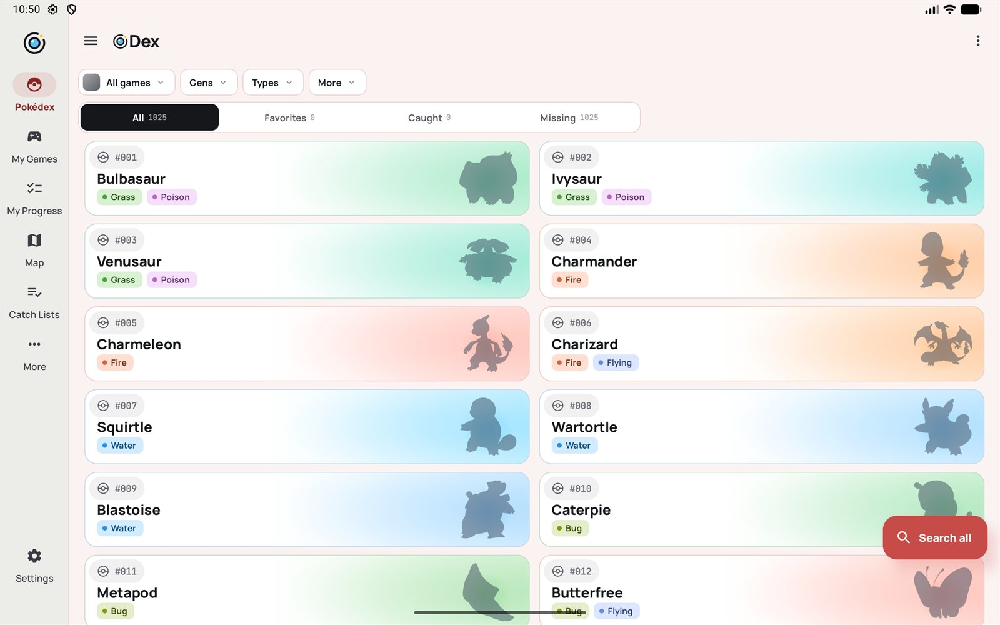
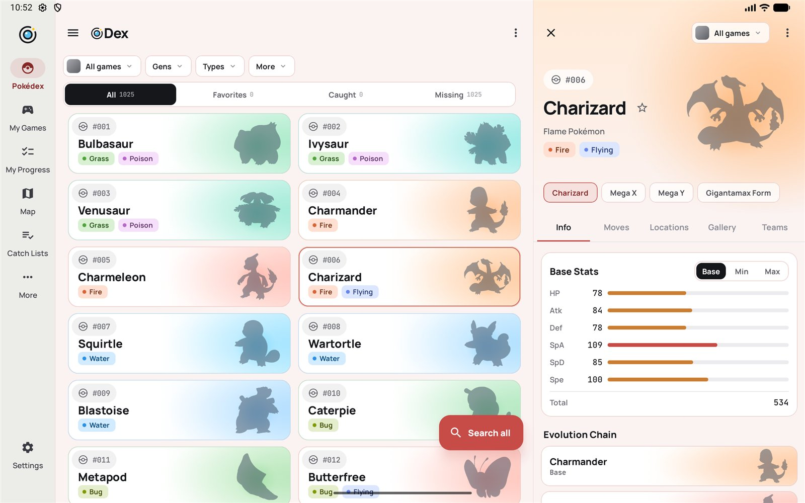
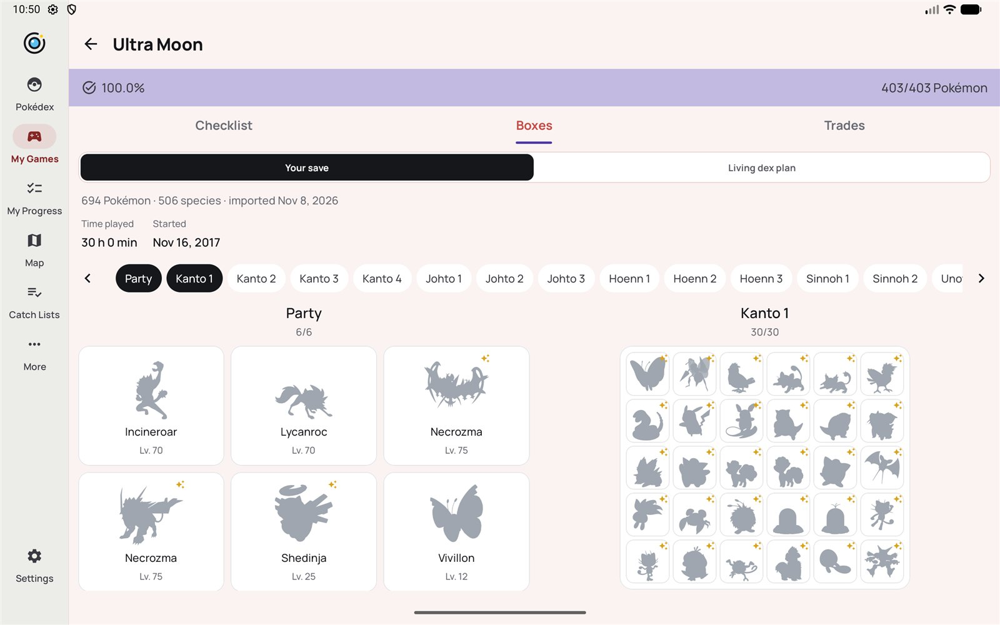
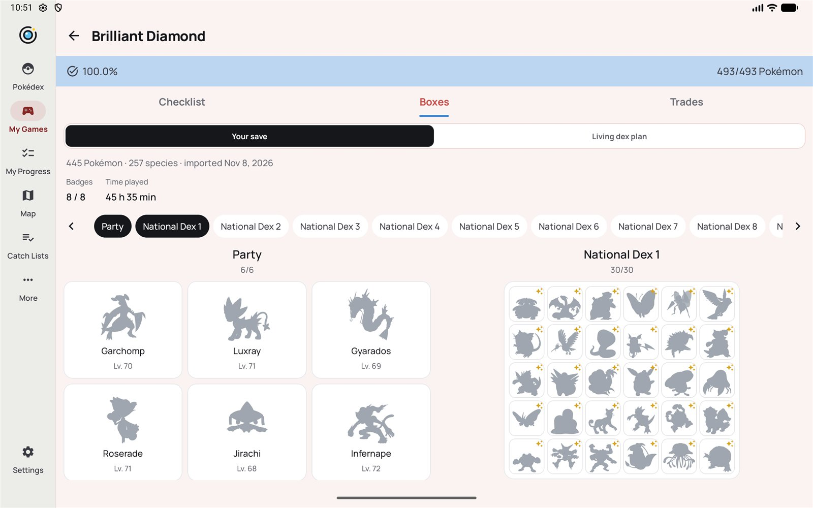

# oDex

**A Pokédex for tracking your own games, saves and catches.** Free, open source, no ads and no account.

oDex covers **every main-series game from Red and Blue to Scarlet and Violet and Legends: Z-A** (39 games) and all 1,025
Pokémon. Keep a checklist for each copy of a game you own, import its save file, plan a playthrough, hunt shinies and
build teams. Game data comes from the [openDex](https://opendex.lemoncore.io) API.

<p>
  
  
</p>
<p align="center"><sub>Screenshots draw Pokémon as silhouettes, so they don't reproduce Nintendo's artwork. The app itself shows the real pictures.</sub></p>
<p>
</p>
<p>
  
  
</p>

## Install

- **Google Play:** in closed testing now, with the public release coming soon.
- **GitHub:** download the APK from the [latest release](https://github.com/du0drag0n/oDex/releases/latest).
- **Obtainium:** add `https://github.com/du0drag0n/oDex` and it will follow the releases.

Play and GitHub builds are signed with the same key, so you can move between them without losing your data. To check an
APK, its signing certificate's SHA-256 fingerprint is:

```
30:59:78:67:77:98:3A:2A:71:E1:49:27:2E:63:59:87:15:3A:83:BD:AD:55:35:B1:4B:5A:B5:7B:37:6E:33:71
```

oDex needs Android 8 or newer. Everything but pictures and cries works offline.

## Import your saves

oDex reads a save file and never changes it. Importing fills a copy's checklist and shows its party, boxes, badges, play
time, start date and details of each Pokémon (nature, ability, held item, where and when it was caught, forms and more).
**Link** a save and oDex re-reads it each time the app opens, so a game played on an emulator updates itself.

| Games | Notes |
|---|---|
| Red, Blue, Yellow, Gold, Silver, Crystal | Cartridge dumps (`.sav`), emulator saves and 3DS Virtual Console saves. Japanese Crystal too. |
| Ruby to Emerald, FireRed, LeafGreen | Emulator saves and cartridge dumps. |
| Diamond to SoulSilver, Black to White 2 | `.sav` from a DS card dump or an emulator, with or without a `.dsv` footer. |
| X, Y, Omega Ruby, Alpha Sapphire, Sun to Ultra Moon | The `main` file from a hacked 3DS. |
| Let's Go Pikachu and Eevee, Brilliant Diamond and Shining Pearl | Save files from a hacked Switch or an emulator. |

Not supported: Sword, Shield, Legends: Arceus, Scarlet, Violet and Legends: Z-A, whose saves are encrypted. Japanese and
Korean saves are only tested for the games listed above. Never share a save in a public place: it holds your trainer
name and ID.

## Features

- **Pokédex:** Pokémon cards coloured from their artwork, filtered by game, generation and type, with each game's own regional dex. Regional variants appear in their region, and forms with their own types or stats have a switcher (Megas, Gigantamax, Alolan and Galarian forms and more). Looks-only forms such as Unown letters and Vivillon patterns are shown as a gallery.
- **Per-game rules:** that game's types and type chart, stats, abilities, moves and their changes over time, evolution methods and available forms.
- **My Games:** log each copy you own (two Emeralds, an English and a Japanese FireRed, an emulator save) with its own caught checklist and National Pokédex setting.
- **Catch Lists:** plan a playthrough or a living dex, grouped by where to find each Pokémon, what to evolve, breed or trade.
- **My Progress, Shiny Dex, Evolution Dex, Team Builder:** completion across your games, shiny checklists and hunts, every evolution family, and teams of six with type coverage and shared-weakness warnings.
- **Other dexes:** Move, Ability, Item, Location, Type (with the type chart) and Nature.
- **Backup:** save favourites, checklists, teams, shinies and imported saves to a JSON file, or turn on automatic backup to a file in Google Drive or anywhere else. Restoring only adds, never removes.
- **Nine languages**, for both the interface and Pokémon names and text: English, French, German, Spanish, Italian, Japanese, Korean and Chinese (Traditional and Simplified).
- **Looks:** a true-black OLED theme and a warm light theme, built in OKLCH so every card is equally bright. Phones and tablets, with a navigation rail on wide screens.

## Privacy

oDex has no accounts, analytics or ads. Your data stays on your device (Android's own device backup may copy it to your
Google account). The app downloads pictures and cries from the openDex API, which sees your IP address like any web
server. See the [privacy policy](https://opendex.lemoncore.io/privacy#odex).

## Where the data comes from

| Data | Source |
|---|---|
| Official artwork | **openDex** `GET /v1/species` (synced daily into Room). Falls back to openDex's game media, which also covers forms. |
| Stats, types, forms, evolutions, encounters, held items, dex entries, moves, abilities, items, natures, and the item and place numbers saves use | `app/src/main/assets/seed/dex.json`, generated from openDex's bulk game data (`GET /v1/game-data`); it records the `dataVersion` it came from |
| Names and text in other languages | `app/src/main/assets/seed/lang/<code>.json`, one pack per language, laid over the English data |
| Move pools and TM/HM/TR lists | `app/src/main/assets/seed/learnsets/<versionGroup>.json`, one pack per game pair, read when that game is picked |
| Game sprites, HOME renders, item icons | openDex `GET /v1/game-media/sprites/…` (cached by Coil) |
| Cries | openDex `GET /v1/game-media/cries/pokemon/…` (`legacy/` for Gen I–V games, `latest/` otherwise) |

The seed ships in the app, so oDex works offline; nothing downloads game data at runtime. openDex in turn builds on
[PokéAPI](https://github.com/PokeAPI/pokeapi)'s data (BSD-3-Clause).

### Gaps in the source data

openDex's data is incomplete for the newest games (`coverage[].noData` in `GET /v1/game-data` lists it per game), and the app says so instead of showing an empty list as fact:

- **Wild locations:** none yet for Legends: Arceus, Scarlet/Violet or Legends: Z-A. Brilliant Diamond/Shining Pearl's are copies of Diamond/Pearl's that openDex marks `borrowed_from`; the generator leaves them out and the app shows Diamond/Pearl's, as it says on the screen.
- **Move pools:** Legends: Z-A has none, and Legends: Arceus has no TM list.
- **Pokédex text:** Scarlet/Violet have only some entries, and Brilliant Diamond/Shining Pearl and Legends: Z-A have none. These fall back to Diamond/Pearl's text for BD/SP, else the most recent entry.
- **Places in saves:** a few met places from Generation V to VII, and all of Let's Go's and Brilliant Diamond/Shining Pearl's, aren't in openDex yet and show the game's name instead.

Regenerating the seed fills these in as openDex adds them.

### Regenerating the seed

1. Run the generator. It downloads the bulk files (about 17 MB, checked against the index's sha256) into a cache folder, then writes `dex.json`, the language packs and the `learnsets/` packs. Pass the `dataVersion` to build from a cached download without the network:

```bash
java -Xmx4g tools/seedgen/SeedGen.java <cache-dir> app/src/main/assets/seed [dataVersion]
```

2. Check what changed against the seed you replaced, and explain every difference.

3. Run the data tests, which assert known facts from every generation and check that `Game` matches the seed:

```bash
./gradlew :app:testDebugUnitTest
```

### Adding a new game

1. **Generator:** nothing to do for a normal release, because every version group is included unless `SeedGen.SKIPPED_VERSION_GROUPS` lists it. For DLC that has its own version group, add it to `PACK_OF` so it shares the base game's move pack.
2. **App:** add an entry to `data/Game.kt` with its version, version group, release order, regional dexes, region and colour. The `game enum matches the seed` test checks the ids. Then add its sprite folder in `data/Images.kt`.

## Building

You need JDK 17+ and the Android SDK (compileSdk 37).

```bash
./gradlew :app:assembleDebug
```

The debug build installs as `io.lemoncore.odex.debug` next to any release build. See [CONTRIBUTING.md](CONTRIBUTING.md) for
tests and pull requests, and [docs/releasing.md](docs/releasing.md) for signing keys, release builds and the Play Console
notes. The Support screen's Ko-fi button comes from `odex.kofiUrl` in `gradle.properties`; pass `-Podex.kofiUrl=` to build
without it.

## Not done yet

- Notifications
- Saves from Sword, Shield, Legends: Arceus, Scarlet, Violet and Legends: Z-A
- Evolution methods and move/ability effect descriptions are English only (openDex has no translations of the effects)
- Per-form caught tracking (the checklist is per species)

## Licence and credits

oDex is licensed under the [GNU General Public License v3.0](LICENSE). Game data is PokéAPI's via openDex, under the
BSD 3-Clause licence. Fonts: Manrope and JetBrains Mono, both under the SIL Open Font License 1.1. The in-app
Settings → About screen lists the libraries used.

Pokémon and Pokémon character names are trademarks of Nintendo, Creatures Inc. and GAME FREAK inc. oDex is an
unofficial fan project, not affiliated with or endorsed by any of them.
